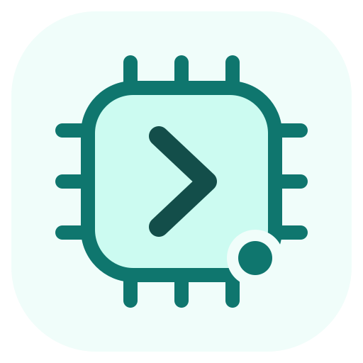

# AutoDL Direct

<picture>
  <source media="(prefers-color-scheme: dark)" srcset="plugins/autodl-direct/assets/icon-dark.svg">
  
</picture>

在 Windows Codex 本机运行，通过 AutoDL 官方 API 管理 Pro 实例，查询公共数据目录和公开库存/标价，并准备专用 SSH 接入。由此私有 Git 仓库分发，采用 MIT 许可证，与 AutoDL、OpenAI 无隶属关系。当前版本为 0.1.8；版本唯一来源为插件的 [Codex 清单](plugins/autodl-direct/.codex-plugin/plugin.json)。验证范围见 [验证记录](plugins/autodl-direct/VERIFICATION.md)。

## 安装与配置

需要 Node.js 22 及以上、支持 `codex plugin` 的 Codex 和 Windows PowerShell。使用有权访问仓库的 GitHub 账号克隆：

```powershell
gh repo clone Puiching-Memory/autodl-direct
Set-Location autodl-direct
powershell.exe -NoProfile -ExecutionPolicy Bypass -File .\plugins\autodl-direct\scripts\Install-Plugin.ps1
powershell.exe -NoProfile -ExecutionPolicy Bypass -File .\plugins\autodl-direct\scripts\Configure-Token.ps1
```

安装脚本验证仓库目录清单指向当前插件，再注册目录并安装。它要求完整仓库，不生成目录清单或支持单独 ZIP 插件包。保留克隆目录；更新时 `git pull` 后重新运行安装脚本，并新开聊天或重启插件连接。

凭据配置只读查询余额验证 Token，再用 Windows DPAPI 加密保存到当前用户的 `%LOCALAPPDATA%\CodexAutoDL\token.dpapi`。输入隐藏，已有凭据无需重复配置。凭据优先级与安全边界见 [SECURITY](SECURITY.md)。不要向聊天提供 Token。

配置后可说：“使用 AutoDL Direct 检查配置，查询我的余额和 Pro 实例。”若 MCP 工具未暴露，使用 [工具说明](plugins/autodl-direct/README.md#查询故障排查) 中的只读入口。

## 功能与职责边界

14 个 MCP 工具涵盖公共数据目录、公开 Pro 库存/标价、专用 SSH 密钥/配置、余额、分页 Pro 实例、状态、私有镜像及生命周期操作。公共查询不需要 Token；GPU 标价不是账户折扣、优惠券和磁盘收费合计后的订单总价。创建/开机可附带公钥安装命令，私钥只在本机。生命周期操作默认预览，`execute=true` 才发送变更请求。接口失败保留脱敏诊断和 request_id；状态可回退到分页列表，变更结果不确定时只读核实并阻止盲目重试。详见 [工具说明](plugins/autodl-direct/README.md) 和 [验证记录](plugins/autodl-direct/VERIFICATION.md)。

| 层次 | 责任 |
| --- | --- |
| 插件 | AutoDL API 参数、鉴权与脱敏、预览、兼容诊断、分页回退、公开库存与标价、专用 SSH 密钥/连接配置、公钥开机安装、变更不确定时核实 |
| Agent | 授权与预算约束、计费前准备、网络路线比较、总体传输并发、监控及按约定收尾 |
| 项目 | 下载缓存、SSH/SFTP、训练环境、任务恢复、PID/日志/退出码、产物摘要与正确性 |
| AutoDL | 库存、价格、计费、调度、实际关机、平台定时关机和内置加速 |
| 宿主与系统 | 浏览器权限、剪贴板、连接、进程权限、DPAPI、SSH 认证和主机验证 |

操作经验保留在 [Skill](plugins/autodl-direct/skills/autodl/SKILL.md)。插件不提供下载器、缓存系统、传输引擎、训练记录、预算计算器或关机看护。普通实例通过现有 SSH 或控制台操作；不提供释放和企业弹性部署。实际价格、库存和环境兼容信息未知时须明确报告。

API 接受请求不等于完成；停止训练不等于平台关机。平台定时设置可从列表观测，匹配不保证执行。插件不能承诺硬预算上限；本地看护会受睡眠、退出或断网影响，远程看护会受实例故障影响。

## 开发与验证

业务源码位于 `plugins/autodl-direct/src/`；MCP 官方 SDK 和 Zod 随 `dist/server.mjs` 打包，安装无需 npm 依赖。许可见 [THIRD_PARTY_NOTICES](plugins/autodl-direct/THIRD_PARTY_NOTICES.txt)。唯一依赖锁为 `tooling/package-lock.json`；构建报告从锁文件读取版本。

在仓库根目录构建和测试：

```powershell
npm.cmd ci --prefix plugins/autodl-direct/tooling --ignore-scripts --no-audit --no-fund
node plugins/autodl-direct/tooling/build.mjs
node --test plugins/autodl-direct/tooling/*.test.mjs
```

离线测试使用无效固定凭据和模拟请求，不读取实际 Token 或执行 GPU 操作。CI 检查 Windows Node.js 22/24。真实只读证据、安装验证、未验证能力和复现方法统一放在 [VERIFICATION](plugins/autodl-direct/VERIFICATION.md)。修改后重建随仓库安装的 dist；发布、安装及付费验证需要对应授权。本次更新已本机安装；未执行付费实例操作，Git 更新不等于创建 GitHub Release。

目录入口为 `.agents/plugins/marketplace.json`，插件清单为 `.codex-plugin/plugin.json`，MCP 配置为 `.mcp.json`。变化见 [CHANGELOG](CHANGELOG.md)，问题报告见 [SECURITY](SECURITY.md)。业务代码与自制图标采用 [MIT](LICENSE)，第三方保留各自许可证。
